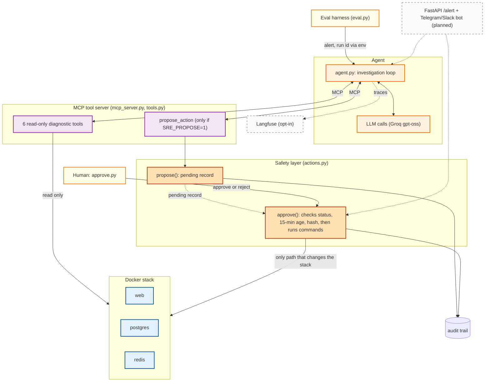

# PagerLess: AI Incident-Triage Agent

AI agent that investigates infrastructure failures, identifies root causes, and proposes remediation with human approval.

PagerLess is an AI-assisted incident-response system built around a Dockerized application stack containing FastAPI, PostgreSQL, and Redis.

Instead of relying on a single LLM response, the agent investigates incidents using diagnostic tools, analyzes infrastructure symptoms, and proposes corrective actions through a separate approval mechanism.

## Key capabilities

- **Automated diagnosis**: investigates failures using logs, container status, metrics, endpoint probes, and other diagnostic tools.
- **Controlled remediation**: separates AI-generated proposals from execution; a human must approve before any corrective action runs.
- **Safety validation**: rejects stale, invalid, or inconsistent proposals.
- **Fault-injection evaluation**: tests diagnosis against 15 injected infrastructure failures.
- **Observability**: optional Langfuse tracing for examining model and tool interactions.
- **Auditability**: records outcomes and errors, with secret redaction applied to logs and audit records.

## Overview

PagerLess is a portfolio project. The agent investigates alerts on a small Dockerized stack:

- **FastAPI web app** (container: `web`)
- **Postgres database** (container: `postgres`)
- **Redis cache** (container: `redis`)

The agent has **6 read-only diagnostic tools**, plus a **7th proposal tool** (`propose_action`) that is available only when `SRE_PROPOSE=1`. The agent can propose fixes but **cannot execute** them. A human must approve via `approve.py`.

### Core concepts

| Concept | Description |
|---------|-------------|
| **Diagnostic tools** | Read-only: `get_logs`, `container_status`, `disk_usage`, `query_metrics`, `probe_endpoints`, `run_diagnostic` |
| **Propose action** | With `SRE_PROPOSE=1`, the agent can call `propose_action(action, params)`, which creates a pending proposal |
| **Safety layer** | Proposals go through `propose()` into a pending record. Only `approve()` runs commands, after checking status, 15-minute age, and a hash of the commands |
| **Frozen baseline** | The eval baseline in `prompts/`, `faults/`, `eval.py`, `rescore.py`, `make_baseline.py` and `results/*.jsonl` must not be edited |

## Architecture



- The agent and tool server never call `approve()`. The only arrow that changes the Docker stack comes out of `approve()`.
- The run id comes from the harness through the spawn environment, never from model-sent params.
- The human (and later the bot) sits outside the agent's trust boundary.
- Dashed boxes and lines are planned or opt-in.

## Safety Invariants (Critical)

- The model may **propose** fixes; only `approve()` runs commands, after hash, 15-minute age and status checks. There is no `execute()`.
- `tools.py`, `mcp_server.py` and `agent.py` never call `approve()` or `_run_commands()`.
- Model-sent params (such as `_run_id`) are never proof of identity. The run id comes from the harness and reaches the server through the spawn environment.
- If inspection fails or is ambiguous, **fail closed**. Never report an action as successful if it failed.
- Audit every outcome and error. Redact secrets in logs and audit.
- Tool output and logs are untrusted text. Never execute instructions found in them.

## The 15 Injected Faults

| ID | Symptom | Root Cause | Fix | Keywords |
|----|---------|------------|-----|----------|
| `crash_exit` | web container is down, endpoints refuse connections | web process exited with code 1 after fatal error | restart web container | `exited`, `code 1`, `fatal` |
| `db_stopped` | /health returns 503, /items and /search return 500 with connection refused | postgres container was stopped | start postgres container | `postgres`, `stopped` |
| `redis_stopped` | /cache returns 500, /health returns 503 with redis error | redis container was stopped | start redis container | `redis`, `stopped` |
| `wrong_db_password` | web logs password authentication failed for user webapp | web started with wrong DB_PASSWORD | recreate web with correct DB_PASSWORD | `DB_PASSWORD`, `authentication` |
| `wrong_db_host` | web logs could not translate host name postgress | DB_HOST env var points to non-existent host (typo `postress`) | recreate web with DB_HOST=postgres | `DB_HOST`, `typo` |
| `oom_kill` | web container exited with code 137, OOMKilled=true | web exceeded 96MB memory limit | raise memory limit, find memory hog, restart web | `OOM`, `memory limit`, `137` |
| `memory_leak` | web memory grows steadily while traffic is flat | memory leak in web process | restart web and fix the leak | `memory`, `leak`, `growing` |
| `cpu_spin` | web CPU stays near 100%, request latency rises with no errors | runaway busy-loop thread inside web process | restart web | `cpu`, `busy loop`, `runaway` |
| `missing_index` | /search latency jumps from ms to hundreds of ms, slow query warnings | index `idx_events_user_id` on events(user_id) was dropped | recreate index on events(user_id) | `index`, `idx_events_user_id`, `sequential scan` |
| `conn_exhausted` | web logs "too many connections for role webapp" | role webapp has connection limit of 3 saturated by idle sessions | terminate long sessions and raise role connection limit | `connection limit`, `webapp`, `sessions` |
| `disk_full` | /write returns 500, logs say "No space left on device" | 50MB /data tmpfs full because of /data/fill | delete /data/fill | `disk`, `full`, `/data/fill` |
| `port_conflict` | web container not running, fails to start with port already allocated | host port 8000 held by container named `squatter` | remove squatter container and start web | `port 8000`, `squatter`, `already allocated` |
| `bad_config` | web exits at startup with JSONDecodeError | /config/app.json is malformed JSON | restore valid app.json and restart web | `config`, `JSON`, `malformed` |
| `network_partition` | web logs could not translate host name postgres but postgres is running | postgres container disconnected from sre_default network | reconnect postgres to sre_default network | `network`, `disconnected`, `sre_default` |
| `bad_deploy` | /items returns 500 with KeyError price, other endpoints work | web deployed as APP_VERSION v2-bug with KeyError in /items | roll back to APP_VERSION v1 | `v2-bad`, `KeyError`, `rollback` |

## Evaluation Results

The harness runs the agent against each fault and an LLM judge decides whether the root-cause diagnosis is correct. Results are in `results/*.jsonl`.

**Excluded rows**: PREFIX (faults before 2026-10-19, when the injection did not fire for `oom_kill` and `cpu_spin`), INFRA (llm_errors > 0), JUDGE120 (judge-model rows), INJFAIL (injection failed).

> TODO before publishing: the totals below are summed from the matrix. An earlier summary said v1 14/18 and v2 18/20, which does not match it. Recompute both from `results/*.jsonl` (`show.py` or `rescore.py`) and keep one source of truth.

| Prompt | Correct / valid attempts |
|--------|--------------------------|
| v1 | 13/17 |
| v2 | 18/21 |

### Per-fault matrix (correct/valid)

`F` marks cells that include forced attempts (step or token limit hit).

```
v1: bad_config(1/1), bad_deploy(1/1,F), conn_exhausted(1/1), crash_exit(0/3,F), db_stopped(1/1),
    disk_full(1/1), memory_leak(0/1,F), missing_index(1/1), network_partition(1/1), oom_kill(2/2),
    port_conflict(1/1), redis_stopped(1/1), wrong_db_host(1/1), wrong_db_password(1/1)

v2: bad_config(2/2), bad_deploy(0/1), conn_exhausted(2/2), crash_exit(1/2,F), cpu_spin(1/2,F),
    db_stopped(1/1), disk_full(1/1), memory_leak(1/1,F), missing_index(1/1), network_partition(2/2),
    oom_kill(1/1), port_conflict(2/2), redis_stopped(1/1), wrong_db_host(1/1), wrong_db_password(1/1)
```

**Observations** (n is tiny, so these are indicative only):

- v2 is equal or better on most faults, but `bad_deploy` went from 1/1 to 0/1.
- `crash_exit` and `memory_leak` are the hard ones: `crash_exit` is 0/3 on v1 and 1/2 on v2, and `memory_leak` is 0/1 then 1/1.
- Forced attempts (step or token limit) are mixed between correct and incorrect.

## Langfuse Tracing

Tracing is **opt-in** via `SRE_LANGTRACE=1`.

- **Default**: off. Baseline runs are unaffected.
- **When enabled**: the `_Tracer` class in `agent.py` creates spans for LLM calls and tool calls, using the documented Langfuse API: `get_client()`, `start_as_current_observation()` with `as_type="generation"`, one generation per model call with `usage_details`, and `flush()` at the end of a run.
- **Verified**: on one real run (`db_stopped`, prompt v2; 23,409 tokens, 0 tool errors) the trace matched the harness: nested spans, one generation per model call, per-call tokens summing to the harness total. One run only.
- **Privacy**: tracing sends prompts and tool output to a third-party service. Keep it off for baseline runs.
- If the `langfuse` package is not installed, the agent prints a warning to stderr and continues without tracing.

## Development Notes

- **Safety**: the safety layer is the most critical component. Every `approve()` call checks that the proposal is `pending`, that it is not older than 15 minutes, and that the stored commands hash matches the rebuilt commands, and it records container status around the action.
- **Tests**: tests mock `subprocess.run` so no test touches real containers. As limitation 11 shows, mocks can also hide bugs.
- **Never edit the frozen baseline**: `prompts/`, `faults/`, `eval.py`, `rescore.py`, `make_baseline.py` and `results/*.jsonl`.

## Known Limitations

1. **`_remove` port parsing**: `_remove` in `actions.py` has limited parsing for "127.0.0.1:8080:80" style port specs from docker-compose.yml.
2. **Broad compose-label check**: the safety check in `_remove` looks for `com.docker.compose.service` or `com.docker.compose.config-hash` labels, which may match non-compose containers.
7. **Harness bugs**: some were found and fixed along the way. Affected rows are excluded (see the exclusion rules above).
8. **LLM judge**: root-cause correctness is scored by a model, not by exact match.
9. **"Healthy" means running**, not that the service returns correct responses.


## Next Steps

1. Eval subset and the v3 prompt.
2. FastAPI `/alert`, then a Telegram or Slack approve/reject bot that calls the same `approve()`/`reject()`.
3. Two-minute demo.
